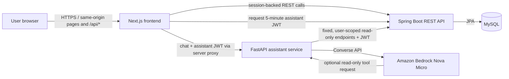

# RTO Tracker Technical Documentation

**Status:** Implementation overview based on the repository as of October 2026. Hosting topology and roadmap are not specified in the source repository.

## 1. Purpose and problem statement

RTO Tracker gives employees and administrators a shared application to plan and review office attendance. It stores each user's planned office days, provides same-platform attendance visibility, and supports administrative event management and weekly reporting. It also supports site-specific free-lunch procurement against saved attendance plans. This centralizes those workflows and their records in one authenticated system.

The application does not currently enforce a company-wide RTO quota or integrate with a company calendar; administrators enter events in the application.

## 2. System scope

### In scope

- Sign-in and role-based access for `USER`, `ADMIN`, `LUNCH`, and `SUPER_ADMIN` capabilities.
- Monthly personal office-day planning, editing future dates, and viewing same-platform daily totals and colleagues' saved plans.
- Global and platform-scoped event management and visibility.
- Weekly RTO reporting with Site, platform, and work-schedule breakdowns.
- User, platform, Site, and work-schedule administration.
- Site-and-date lunch procurement, recipient snapshots, credential scans, and receipt tracking.
- An optional RTO planning assistant that can read the current user's schedule, visible events, and permitted aggregate attendance data.

### Out of scope in the current implementation

- Company calendar synchronization and public self-registration.
- Automated enforcement of an organization-wide RTO policy.
- Assistant writes to schedules or access to other platforms' private attendance.
- Account self-service password reset, invitation, deactivation, or credential rotation workflows.

These boundaries describe the current implementation, not necessarily future product decisions.

## 3. Applications and component responsibilities

The repository contains three independently configured applications. They form a service-oriented application; the source does not establish a formal microservice ownership or deployment topology.

| Application / component | Stack | Responsibilities |
|---|---|---|
| Web frontend (`next-frontend`) | Next.js 16 App Router, React 19, TypeScript, Tailwind CSS 4, shadcn/Radix UI, React Hook Form, Zod | Renders planner, admin, reporting, events, and lunch workflows; manages client view state and form validation; checks the authenticated session for protected navigation; forwards browser API requests through same-origin `/api/*` routes. |
| Core REST API (`spring-backend`) | Java 25, Spring Boot 4.1.1, Spring MVC, Spring Data JPA, Bean Validation, Maven | Owns business rules, authorization, authentication/session lifecycle, schedule and domain APIs, reporting, procurement, persistence, and assistant-token issuance. |
| RTO assistant service (`bedrock-ai-service`) | Python 3.11+, FastAPI, Uvicorn, boto3, PyJWT, httpx | Validates assistant JWTs and chat input, invokes Amazon Bedrock Nova Micro, validates allowlisted read-only tool calls, and queries fixed Spring assistant endpoints. It does not persist schedules and has no schedule-write tool. |
| Relational database | MySQL; schema migrations managed by Flyway and mapped with JPA | Persists accounts, roles, organizational assignments, events, office-day records, and lunch procurement/receipt records. |
| Amazon Bedrock | Nova Micro model via AWS SDK | Generates assistant responses and may request declared read-only data tools. AWS credentials and model access are external runtime prerequisites. |

### Core API domains

- **Authentication and authorization:** login, current session, logout, assistant JWT, role and admin checks.
- **Users and organizational assignments:** users, roles, platforms, Sites, and work schedules.
- **Office planning:** authenticated monthly schedule reads/replacements and same-platform colleague views.
- **Events:** global and platform-scoped event persistence, visibility, and management.
- **Reporting:** Monday–Friday weekly attendance aggregation and group breakdowns.
- **Lunch procurement:** Site/date locks, eligible roster snapshots, receipt scans, and calendar date indicators.
- **Request safeguards:** input validation, origin checks on state-changing requests, credentialed CORS, and bounded in-memory API rate limits.

These are modules within one Spring Boot API application, not separately deployed services according to the repository.

## 4. System flow

1. A user signs in through the frontend; Spring validates credentials and establishes an HTTP session. The browser uses same-origin frontend routes for API calls. Next.js proxies normal `/api/*` traffic to Spring.
2. The frontend loads the user's session and feature data. Spring applies role and ownership checks and reads/writes application records in MySQL.
3. The planner loads monthly office-day plans and same-platform daily counts together. Saving replaces eligible future dates while preserving locked past/today entries.
4. For assistant chat, the frontend obtains a short-lived, five-minute JWT from Spring using the signed-in session. It sends chat to a same-origin Next.js route, which proxies to FastAPI. The Spring session cookie is not sent to FastAPI.
5. FastAPI verifies the token and invokes Bedrock. If the model requests a declared tool, FastAPI validates it and calls a fixed Spring read endpoint with the JWT. Spring derives the user/platform from the token. The tool results return through FastAPI to Bedrock and then to the browser. Assistant suggestions are drafts and are not saved.

## 5. Data and security boundaries

- MySQL is the durable system of record; Flyway migrations define its schema and Hibernate validates entity mappings.
- Spring HTTP sessions authenticate interactive application requests. The assistant uses a separate RS256 JWT with issuer, audience, expiry, subject, and scope validation.
- Assistant read tools are limited to the caller's visible events, own saved schedule, and permitted same-platform aggregate attendance. They do not expose colleague email addresses or mutate schedules.
- Office-day colleague views exclude the signed-in user and are scoped to that user's platform.
- State-changing API calls are checked against configured browser origins. Session cookies are HTTP-only and SameSite Lax; production enables secure cookies.
- API rate limiting is currently backed by bounded in-memory state. It resets on restart and is documented for a single backend instance; multi-instance deployment needs shared or gateway-level limiting.
- Production profile disables Swagger/OpenAPI and suppresses default error details. Production deployment settings include database credentials and frontend origin through environment configuration.

## 6. Technical stack

| Layer | Technologies |
|---|---|
| Frontend | Next.js 16.4.2, React 19.3, TypeScript 5, Tailwind CSS 4, shadcn/Radix UI, React Hook Form, Zod, ESLint 9 |
| Core API | Java 25, Spring Boot 4.1.1, Spring MVC, Spring Data JPA, Spring Validation, Spring Security Crypto / OAuth2 JOSE libraries, Maven |
| AI service | Python 3.11+, FastAPI, Uvicorn, boto3, PyJWT with crypto, httpx, python-dotenv |
| Persistence | MySQL, Flyway migrations, Hibernate/JPA |
| AI runtime | Amazon Bedrock Nova Micro |
| API documentation | springdoc OpenAPI / Swagger UI in non-production; FastAPI docs at `/docs` |

## 7. Future enhancements

The following planned work is conditional on deployment approval:

- **Company identity provider integration:** connect the organization's identity provider and use it to display accurate, up-to-date user information. The provider, authentication protocol, and user attributes to synchronize are still to be determined.
- **Lunch workflow discovery:** review the current process with the lunch management team, validate how the application should support it, and capture requirements for subsequent work.
- **Cloud monitoring:** select and configure cloud monitoring solutions for the deployed application. The cloud provider, monitoring products, and required signals/alerts have not yet been specified.

Other product decisions remain open, including company-calendar integration and ownership, RTO policy enforcement, account lifecycle workflows, user schedule visibility, historical data retention, and shared rate-limit storage if the API is scaled horizontally. These are not yet approved roadmap items.

## 8. Open decisions for product and deployment owners

- Which identity provider and identity attributes should be integrated after deployment approval?
- What does the lunch management team's validated workflow require?
- Which cloud provider, monitoring tools, signals, and alert owners are intended?
- What is the definitive RTO policy and who maintains company events and requirements?
- What account lifecycle and historical data retention behavior is required?
- What is the intended production hosting topology, AWS account/region, and operational ownership?

## 9. Related references

- [Product requirements](REQUIREMENTS.md)
- [Repository overview](README.md)
- [Frontend project notes](next-frontend/PROJECT_NOTES.md)
- [Backend project notes](spring-backend/PROJECT_NOTES.md)
- [Assistant service notes](bedrock-ai-service/PROJECT_NOTES.md)
